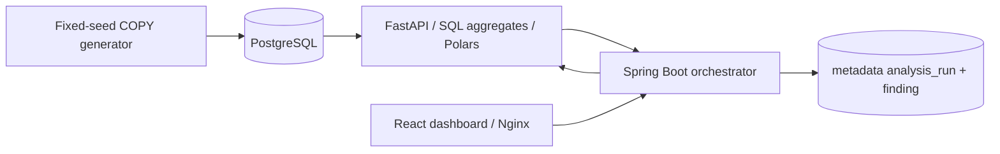

# Architecture

PostgreSQL contains `prod_snapshot` and `test_env` with customer, account, loan, and card tables. Primary keys, required foreign keys, status checks, and customer indexes protect relational integrity. The independent `metadata` schema records generator provenance, all analysis attempts, full successful JSON snapshots, and findings.

The generator streams batches of 2,000 customer bundles through psycopg COPY in one transaction. It uses a fixed UTC business reference timestamp and two deterministic PRNG streams. It locks generation, refuses replacement or accidental appends, and records its seed/version/count only after the whole dataset succeeds.

FastAPI performs each analysis in a repeatable-read, read-only transaction. Column summaries, foreign-key health, and per-customer relationship aggregation execute in PostgreSQL. Each relationship table is reduced before joining customers, preventing loan/card/account fanout. Python receives only column-summary rows and bounded feature groups. Polars merges groups differing only in customer status into exact six-feature states.

Spring holds a PostgreSQL advisory lock while orchestrating a run. It records RUNNING, calls the internal analysis endpoint with a bounded timeout, and atomically saves successful results and finding rows. Failures are recorded as FAILED and never replace the previous successful snapshot. An abandoned RUNNING attempt is marked interrupted when a subsequent run obtains the lock. Old finding details remain accessible by ID.

React fetches actual API results, shows explicit loading/empty/error states, triggers analysis, filters findings and states, compares fingerprints, and fetches persisted finding details. Nginx serves static assets and proxies `/api` to Spring on the project network. Finding detail now includes lazy Turkish explanations from an optional remote-only Ollama adapter, with deterministic fallback. Overview and analysis remain independent of inference. There are no repair controls. See [LLM integration](LLM_INTEGRATION.md).

Compose has four services, one dedicated bridge network and one dedicated PostgreSQL volume. PostgreSQL/analysis are network-only. Frontend and backend bind host loopback ports 18080/18081. Application containers run without privileges, host networking, Docker socket mounts, or preserved-project mounts. Python/Java/frontend have read-only roots with bounded temporary mounts. The database entrypoint needs a writable root to initialize its standard runtime directories.

Small shared-vCPU hardware is adequate for a sequential demonstration. This is not a throughput benchmark or a production tenancy guarantee. CPU, memory, connection, thread, and log limits protect headroom; host disk and kernel remain shared.
